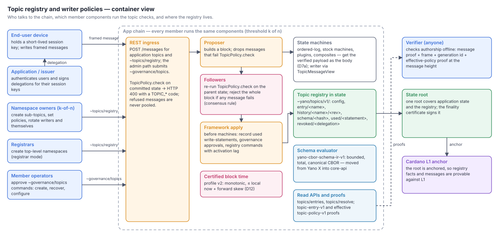
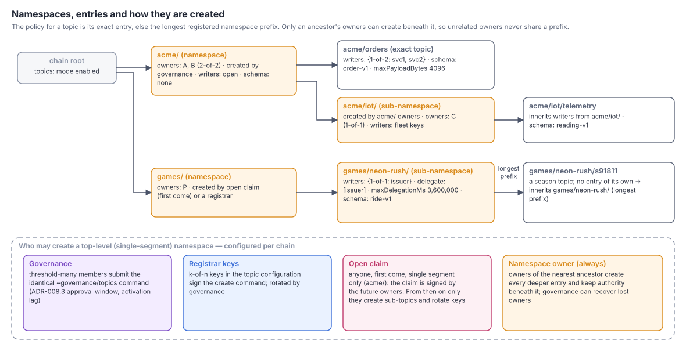
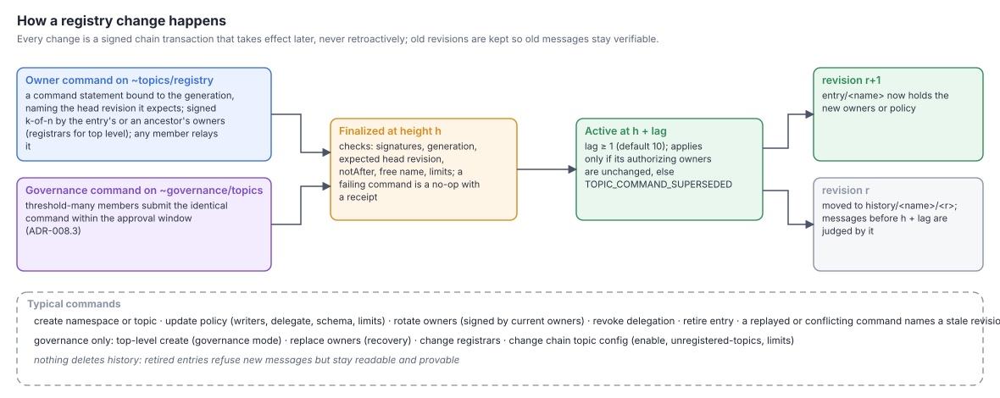
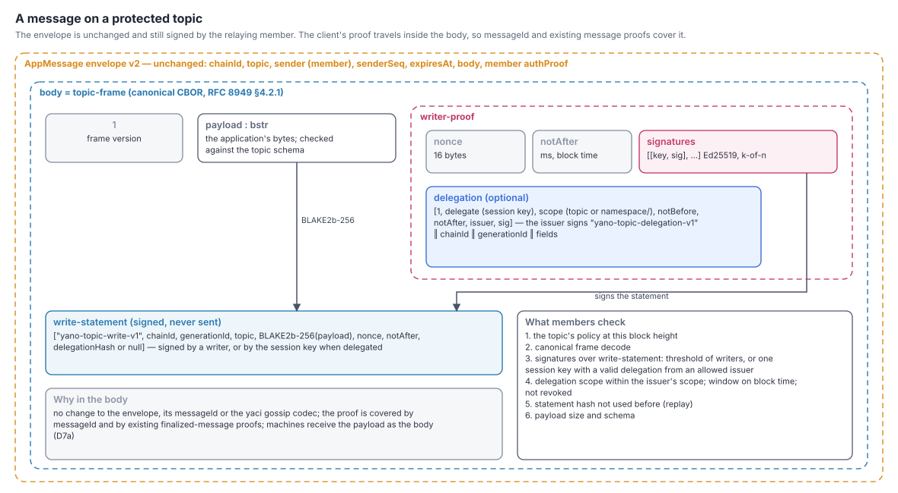
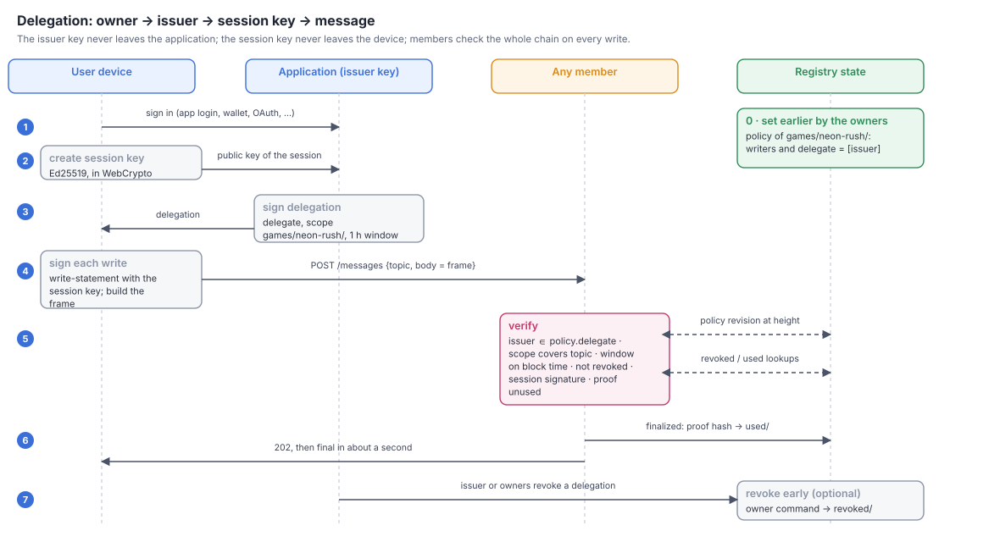
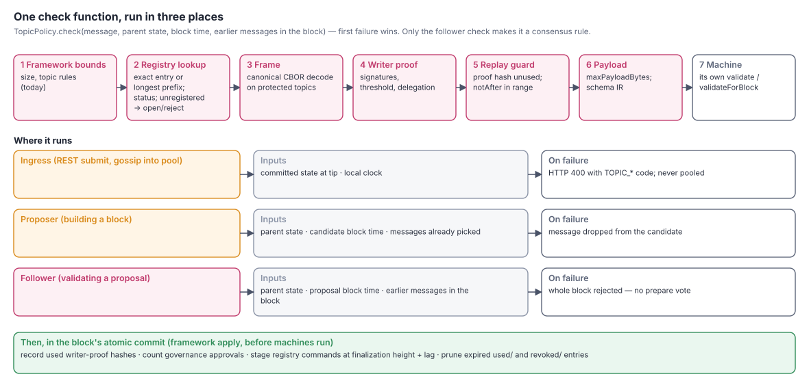

# ADR-039: Topic Registry, Namespaces and Writer Policies

## Status

Accepted (design approved at `f13207952`, 2026-10-23; the maintainer's OQ10
decision was recorded afterwards in r11, 2026-10-24). At the maintainer's
direction, milestones M0–M6 (§10) are implemented in the same PR; the
implementation notes are revisions r12–r20. The production and audit gates
(§12) remain open.

The number is local to the `adr/app-layer` series. Root-level and
`adr/in-progress` ADR numbers are separate series; in particular, this is not
the in-progress ADR-039 on the canonical projection outbox.

## Date

2026-10-22

## Owners

Yano app-chain host: `runtime/appchain` (admission, block validity,
framework apply), `core-api` (registry types, payload/writer view, schema
evaluator), and the REST resource in `app`. Yano X owns authoring tools,
Studio, composites and stdlib reuse; see the companion
[Yano X ADR app-layer/038](https://github.com/bloxbean/yano-x/blob/main/adr/app-layer/038-topic-policy-integration-schemas-rules-and-tooling.md).

## Risk

**High.** The design adds consensus rules (block validity), a framework-owned
state namespace, signature verification of client evidence, and governance
paths. A defect can split members, admit forged writes, or lock owners out.

## Related decisions

- [ADR-005](005-yano-app-chain-framework.md) — the app-chain subsystem, the
  reserved `~` topic prefix (D7) and the member-signed envelope.
- [ADR-008.3](008.3-chain-governed-membership.md) — governance messages on a
  reserved topic, approval by threshold-many identical commands, activation
  lag, a framework handler atomic with the block. This ADR reuses that
  mechanism for topic governance instead of inventing a second one.
- [ADR-010.1](010.1-emission-versioning.md) — height-indexed framework epochs.
- [ADR-011](011-plugin-architecture.md) — the plugin API and its API levels.
- [ADR-016](016-authenticated-appchain-consensus-profile-and-typed-runtime-limits.md)
  — reserves `~yano/` for framework-authenticated state, commits the
  consensus profile (today schema version 2, under
  `~yano/consensus-profile/v2`), and explicitly leaves "application-schema
  evolution" out of the profile (§3.1). This ADR fills that gap for topics.
- Yano X ADR app-layer/025.1 (declarative value schemas for the authenticated
  map) — the source of the `yano-cbor-schema-ir-v1` evaluator that this ADR
  moves into core.
- Yano X ADR app-layer/031.3 and 031.4 — forbid-only admission rules for
  composite components; the companion ADR extends their views to typed topic
  payloads and verified writers.

---

## 0. In plain words

Every app message already carries a **topic**. Today the topic is only a
label: any client that can reach any member can post any body to any topic,
and the members cannot tell *who* wrote it — the envelope is signed by the
member that relayed it, not by the client.

This ADR lets a chain opt in to a **topic registry** that every member keeps
in consensus state:

- A **namespace** such as `acme/` has **owners** (keys, k-of-n). Only they
  can create topics under it, change their policies, or rotate themselves.
- Each **topic** has a **policy**: who may write (anyone, or a set of keys),
  whether those writers may **delegate** to short-lived **session keys**, and
  an optional **schema** for the body.
- Namespaces are created by **governance** (members vote), by **registrar**
  keys, by a **namespace owner** (sub-namespaces), or — if the chain allows
  it — by an **open first-come claim**.
- A client writing to a protected topic attaches a **writer proof**: its
  signature, or a session key's signature plus a **delegation** signed by an
  authorized writer. Every member checks the chain *owner → delegate →
  message* before the message can enter a block.
- Policy changes are signed chain transactions that take effect at a later
  height, never retroactively, so every historical message stays verifiable.

A chain that does not opt in behaves exactly as today.



---

## 1. Context

Facts this design builds on, checked at `origin/main` `a4e28babf` (yano) and
`origin/main` of yano-x on 2026-10-22:

1. **Envelope.** `AppMessage` (yaci `core/.../appmsg/model/AppMessage.java`)
   is v2: `[version, messageId, chainId, topic, sender, senderSeq, expiresAt,
   body, [authScheme, authProof]]`. `messageId` is BLAKE2b-256 over
   `[chainId, topic, sender, senderSeq, expiresAt, body]`. `sender` and
   `authProof` belong to the **relaying member**; `body` is opaque and "never
   interpreted by the transport or sequencing layers".
2. **Submission.** REST `POST /api/v1/app-chain/chains/{chain}/messages`
   takes `{topic, body | bodyHex}`; the member wraps it in an envelope it
   signs. `AppChainSubsystem.submitWithinGeneration` refuses empty bodies,
   bodies above `max-message-bytes` (65,536 by default), invalid topics, and
   any topic starting with `~` ("reserved for the framework").
3. **Admission hooks.** `AppStateMachine.validate` and `validateForBlock` are
   per-machine. Since commit `36c88a6ba` (host 0.1.0-pre17) a refusal at
   submit is HTTP 400 with a code (`validateLocalSubmission`); the proposer
   drops refused messages when building a block (`AppChainEngine`, the
   `validateForBlock` filter).
4. **Followers.** A follower validating a proposal checks every message's
   profile, id, expiry and member signature, and rejects the whole block if
   it contains an effect result from a non-designated signer
   (`authorizedResultMessage`) — a precedent for a policy rule in block
   validity. It then re-executes the block and compares the state root.
5. **Block time.** The proposer stamps `System.currentTimeMillis()`; the
   follower check in `validBlockProfile` is only `timestamp >= 0`. Nothing
   enforces monotonic or bounded time (see D12).
6. **Governance.** ADR-008.3 governs membership through `~governance/membership`
   (threshold-many identical commands, activation lag, framework handler,
   atomic commit). `submitPrivilegedSystemMessage` accepts only
   `~governance/` topics through an admin path.
7. **Framework state.** ADR-016 reserves `~yano/` for framework-authenticated
   state inside the committed state root.
8. **Schemas.** Yano X's `AuthenticatedMapSchema`
   (`state-machines/stdlib-contracts`) is a bounded, total evaluator of the
   canonical `yano-cbor-schema-ir-v1` (max 65,536 IR bytes, 2,048 nodes,
   depth 32, 262,144 evaluation steps; no references or recursion). The
   `cddl-yano-subset-v1` → IR compiler lives in Yano X `tooling/devtools`.
   Only authenticated-map collections use it today. `ordered-log`'s own
   documentation says "schemas and transitions need another machine or a
   plugin".

### 1.1 Problems

- **P1 — No consensus write authorization.** Write access is enforced only at
  each member's edge (API keys, CORS). It is not part of consensus, not
  portable across members, and not provable.
- **P2 — No structure for logs and custom machines.** Junk on an
  `ordered-log` topic is stored forever; every consumer re-validates.
- **P3 — No safe way to give end users write access.** Declaring keys at
  genesis does not scale to thousands of users or to rotating devices.
- **P4 — Topics cannot be created or governed on a running chain.** Any
  ownership convention is off-chain.
- **P5 — Block time is unchecked**, so any time-based rule (expiry) is only as
  honest as the proposer.

## 2. Goals and non-goals

**Goals**

- G1. Opt-in, consensus-enforced writer authorization per topic, the same for
  `ordered-log`, the other stock machines and custom plugins.
- G2. Namespaces with owners, created in four modes; owners create sub-topics
  and rotate their own keys; governance can recover.
- G3. Short-lived delegations (session keys) so applications can give end
  users write access without key ceremonies.
- G4. Optional per-topic body schemas (canonical CBOR, bounded evaluation).
- G5. Everything provable from the state root and anchored on L1 like any
  other state.
- G6. A small, maintainable core: one registry, one frame, one check
  pipeline, reusing existing governance and schema code.

**Non-goals**

- Read access control or confidentiality (all members see all bytes).
- Rate limiting and quotas (left as an extension point; see OQ7).
- Wallet-native key schemes (CIP-8/CIP-30 message signing) in v1 (OQ6).
- Changing the transport envelope or yaci wire protocols.
- Business rules beyond structure (that is what state machines and Yano X
  admission rules are for).

## 3. Terms

| Term | Meaning |
|---|---|
| **Topic** | The existing envelope field. Up to 256 UTF-8 bytes; must not contain NUL or start with `~`. |
| **Namespace** | A registered topic prefix ending in `/`, e.g. `acme/`, `acme/orders/`. |
| **Owners** | A key set with a threshold (k-of-n) that controls a namespace. |
| **Registry entry** | A namespace or exact topic record, with its policy and revision history. |
| **Policy** | Writers, delegation rights, schema and status that apply to topics under an entry. |
| **Writer** | A key allowed to write to a protected topic. |
| **Delegation** | A statement signed by a writer: "key X may write to scope S from T1 until T2". |
| **Session key** | The delegate key, typically generated in a browser or device. |
| **Writer proof** | The signatures (and optional delegation) attached to a message on a protected topic. |
| **Frame** | The canonical CBOR body wrapper that carries the payload and the writer proof. |
| **Payload** | The application's bytes inside the frame (or the whole body on an open topic). |
| **Generation id** | `StateCommitmentIdentity.digest()`: 32 bytes over the commitment profile, format fingerprint and genesis id. Distinct chain generations can share a `chainId` but never a generation id. |
| **Head revision** | An entry's latest revision, whether already active or still pending activation (D5a). |

---

## 4. Decisions

### D1 — Opt-in per chain; disabled means unchanged

```yaml
yano.app-chain.chains[n].topics:
  mode: disabled | enabled            # default: disabled
```

With `mode: disabled` the topic registry does not run: no `~yano/topics/`
keys are written and no frame is parsed. Such a chain differs from today only
by the D12 time rules, which every chain gets through the one consensus
profile (D12, I1). Enabling topics requires chain-governed membership
(`membership.mode: governed`,
ADR-008.3): the governance commands of D5 — top-level creation in
`governance` mode, owner recovery, registrar and configuration changes — use
ADR-008.3 approval accounting, which today runs only in governed mode
(`GovernedMembership` is created only when `membership.mode` is `governed`).
Static-membership chains therefore cannot enable topics in v1 (OQ11, decided).
Enabling is a genesis choice for new chains, or a governed height-activated
change on an existing chain (D13).

**Configuration authority** (the ADR-008.3 §2.4 rule for member lists). The
`topics:` YAML block is the **genesis seed only**. When a chain enables
topics at genesis, the seed is written to `~yano/topics/v1/config` while
block 1 is applied, after its messages, like any configuration activation
(D5a with *a* = 2). It therefore governs blocks from height 2. **Block 1 of a
genesis-enabled chain is governed as *disabled*:** it behaves exactly as
today for writes and owner commands. `~` topics are refused at REST, and no
policy or `reject` fallback applies yet; no entry can be active before height
2 anyway. Governance commands in block 1 are the one exception: they are
judged under the seed, so a vote in block 1 counts as it would in block 2. The alternative,
an authenticated configuration in the parent state of block 1, does not
exist today: framework state starts at height 1 (`ConsensusProfileGuard`
refuses a marker before it), so height 0 has no committed configuration to
prove against, and an unproven YAML value must not stand in for one. The
YAML seed is **read only while applying block 1**: on a new chain, a member
joining from genesis, or a full resync. A member that applies block 1 with a
different seed computes a different height-1 root, so its block 1 fails the
state-root check and it never joins (fail closed). Like ADR-008.3's genesis
member list, the YAML used for such a start must hold the seed. At every other
height the YAML is never read, even by governance commands: the committed
`config` record is the only authority, governed changes (D5, D13) replace it
at their activation height, and every member reads it from state. A restart
whose seed differs from the genesis configuration (revision 1) logs a
warning and changes nothing. An operator keeps the seed in the YAML for a
later full resync. A chain that enables topics later does so with a governance
command that carries the whole initial configuration; its YAML `topics:`
block is not used. Superseded configuration revisions are kept under
`history/~config/<revision>`, so the seed and every later configuration stay
provable.

### D2 — The registry is framework-authenticated state under `~yano/topics/v1/`

The registry lives inside the chain's state root, next to the ADR-016
consensus profile, so every entry is provable and anchored with no new proof
machinery. Illustrative key layout (normative encoding fixed in M1):

| Key | Value |
|---|---|
| `~yano/topics/v1/config` | Effective chain-level topic configuration (D1, D4, D14), **bounded** (registrar set ≤ 16 keys): mode, creation modes, registrars, `unregistered-topics`, limits, and its revision number. Absent on a chain that has not enabled topics. |
| `~yano/topics/v1/entry/<name>` | Namespace or exact-topic record, **bounded**: the active revision (owners, policy, status, revision number, `activeFrom`), materialized by the framework (D5a), plus small head metadata (head revision number, pending count). A record with no active revision yet (a pending creation) reserves the name but governs nothing. Pending revisions are never stored here. |
| `~yano/topics/v1/queued/<name>/<revision>` | One pending revision: its content, activation height and recorded authority epoch. Removed when it activates or is cancelled. |
| `~yano/topics/v1/history/<name>/<revision>` | Superseded revisions, kept so old messages stay verifiable (D13). Configuration revisions use the name `~config` (D1). |
| `~yano/topics/v1/schema/<irHash>` | Schema IR bytes, content-addressed (D10). |
| `~yano/topics/v1/used/<statementHash>` | Replay guard: the hash of a used write-statement (not of its signatures), removed after its `notAfter` (D9). |
| `~yano/topics/v1/revoked/<delegationHash>` | Early-revoked delegations, keyed by the hash of the unsigned delegation, removed after the delegation's `notAfter` (D8). |
| `~yano/topics/v1/expiry/<queue>/<height>`, `expiry-item/<queue>/<height>/<index>`, `expiry-head/<queue>`, `expiry-tail/<queue>` | Expiry batches (D9): a fixed-size header per block (latest `notAfter`, next batch, item count, pruned count) and one key per item, linked in height order, in two queues of uniform retention: credentials (`used/`, `revoked/`) and receipts. The state API has no ordered key scan, so the index is a linked list rather than a key range; no record grows with the number of messages in a block. |
| `~yano/topics/v1/governance` | Governance approvals in progress: one bounded record (at most 64 commands; each member's approvals are on at most an equal share of them, 64 ÷ members) of command hash, first-seen height and approvers, using ADR-008.3 accounting (consensus threshold at the counting height, approval window; a removed member's approvals are dropped). |
| `~yano/topics/v1/config-pending` | The revision of the one pending configuration change, if any (D5). |
| `~yano/topics/v1/activation/<height>`, `activation-item/<height>/<index>` | How many revisions activate at that height, and each one (entry name and revision, or `~config`, with the id of the command that queued it) in inclusion order; materialized while applying block *height − 1* (D5a). A ticket installs only the revision its command queued, so a ticket left by a cancelled creation never installs a later creation of the freed name. |
| `~yano/topics/v1/receipt/<messageId>` | The outcome of a registry or governance command (`ACCEPTED` with its activation height, or a receipt code), kept for `max-command-ms` after inclusion. |
| `~yano/topics/v1/count` | Entries in the registry, pending creations included (the `max-entries` counter); a top-level record keeps its subtree count. |

Application machines cannot write under `~yano/` (ADR-016 reserved prefix).
Physical keys hash names (BLAKE2b-256 of the UTF-8 name) so every key stays
under the 256-byte proof-key bound; the normative layout is
`TopicKeys` and the record formats are `META-INF/yano/topics/v1/topics.cddl`
(M1).

### D3 — Names: `/`-separated namespaces, longest prefix wins

- A namespace name is one or more segments of `[a-z0-9._-]{1,64}`, each
  followed by `/` (`acme/`, `acme/orders/`). An exact topic entry is any
  valid topic under a namespace.
- The policy for a message is the **exact topic entry if present, otherwise
  the longest registered namespace prefix** of its topic. Child entries
  replace inherited fields they set and inherit the rest.
- **Allocation (I6).** A *top-level* entry — created by an open claim, by
  registrars or by governance — is a single segment: a namespace such as
  `acme/`, or an exact topic without `/` such as `orders.v1`. Every deeper
  entry (`acme/orders/`, `acme/orders/new`) is created only by the owners of
  its nearest existing ancestor namespace. A multi-segment name can therefore
  never be claimed while its ancestors are free, so neither order —
  child-then-parent or parent-then-child — can leave two unrelated owners on
  overlapping prefixes. Name checks count pending creations as taken (D5a),
  and entries are never deleted (they are retired), so a name is never freed.
- **Authority.** The owners of an ancestor namespace keep authority over the
  entries beneath it: they may update, rotate or retire a descendant with a
  command whose `authority` is the ancestor (D5a). A child's own owners act
  only within their subtree. Child ownership is thus delegated by the parent,
  never in conflict with it. Whether a parent may give that authority away
  is OQ9.
- Existing dot-style topics (`orders.v1`, `neon-rush.v1.s123`) are valid
  topics; they can be registered as exact entries or live under a namespace.
  Whether to also allow `.` as a namespace separator is OQ1.

### D4 — Four creation modes, chosen per chain

| Mode | Who creates a top-level namespace | Typical use |
|---|---|---|
| `governance` | members vote: the chain's consensus threshold of distinct members submit the identical command (ADR-008.3) | consortium chains |
| `registrar` | k-of-n registrar keys declared in the topic configuration, rotated by governance | a platform team operating the chain |
| `open` | anyone, first come, by a claim signed by the future owners (single-segment names only, D3) | public or developer chains |
| `namespace-owner` | the owners of an existing namespace, for sub-namespaces and topics beneath it | always available once a namespace exists |

```yaml
yano.app-chain.chains[n].topics:
  mode: enabled
  creation:
    governance: true
    registrars:                      # absent or keys: none = no registrars
      threshold: k
      keys: <hex32>,<hex32>          # comma-separated
    open-claims: false
  unregistered-topics: reject        # or: open (D14)
  max-delegation-ms: 3600000         # at most 365 days, like max-command-ms
  max-command-ms: 604800000          # D5a
  max-pending-per-entry: 4           # D5a
  max-entries: 100000
  max-entries-per-namespace: 1000    # entries in one top-level subtree, itself included
  activation-lag: 10                 # blocks (D5)
  governance-window-blocks: 600      # approval window of topic governance (D5)
```

`namespace-owner` is not a switch; it is how every namespace grows. An
**open claim** makes the claimant's keys the owners of a new top-level
namespace; from then on only those owners create sub-topics and rotate keys,
exactly as for any other namespace. A creation that would exceed
`max-entries` or the `max-entries-per-namespace` cap of its top-level subtree
is refused with `TOPIC_COMMAND_LIMIT`. Pending creations count toward both caps. The
subtree cap stops one owner from filling the chain-wide cap with children
and locking out governance and registrar creations. Many open claims by
different claimants are the squatting case of OQ7.

The three top-level modes are **independent switches**; any combination,
including all three, may be on. `registrars: none` (or an absent registrar
set) turns the registrar path off, and commands with authority `~registrars`
are then refused with `TOPIC_COMMAND_DENIED`. With all three off, no new
top-level entry can be created until a governance configuration change turns
one on; governance itself is always available on a topics chain (D1).

**Recommended profiles.**

| Profile | `governance` | `registrars` | `open-claims` | `unregistered-topics` | Why |
|---|---|---|---|---|---|
| **Production** (default recommendation) | `true` | `none` | `false` | `reject` | No single key can create a top-level entry: each needs the same member threshold that finalizes blocks, so the design adds no trusted party. A vote is needed once per tenant; owners then run their subtree alone. `reject` closes the unregistered-topic gap (D14). |
| **Devnet / showcase** | `true` | one key, `threshold: 1`, held by the operator | `false` | `reject` | One signed CLI call creates a namespace without coordinating votes; governance stays the backstop for recovery and configuration. |
| **Public developer chain** | `true` | `none` | `true` | `open` | First-come self-service, bounded by the caps; squatting is OQ7. |

A production chain that later wants registrars adds them with a governance
configuration change; registrar keys in production should be k-of-n and held
in hardware or a KMS.



### D5 — Two command paths, both on reserved topics

1. **Owner commands** on `~topics/registry`: create a sub-namespace or topic,
   update a policy, rotate owners or writers, revoke a delegation, retire an
   entry, and (in `open` mode) claim a top-level namespace. Each command is
   signed by the owners (k-of-n) of the affected entry or of an ancestor
   namespace (D3), or by registrars for top-level creation, over a
   generation-bound command statement (D5a). **Any member may relay** these: REST
   accepts `~topics/registry` as the one user-submittable `~` topic, because
   the framework verifies the owner signatures inside the command, not the
   relaying member.
2. **Governance commands** on `~governance/topics`: create a top-level
   namespace (governance mode), replace owners of any entry (recovery),
   change registrars, change the chain topic configuration, or retire an
   abusive entry. These are approved exactly like membership changes: once
   distinct members numbering the chain's **consensus threshold** at that
   height (`group.thresholdAt(height)` in ADR-008.3's `GovernedMembership`,
   the same number of signatures that finalizes a block) have submitted the
   identical command within the approval window (`governance-window-blocks`,
   committed in the topic configuration because it decides consensus state;
   600 blocks before topics are enabled). Each member submits through
   its node's privileged admin path, which requires a configured full API key
   (`AppChainApiKeyFilter`; without one the route answers `AUTH_UNAVAILABLE`)
   and signs with that node's member key. There is no separate topic
   threshold; a governed threshold change applies to topic governance from
   its activation height. At most one configuration change is pending at a
   time (a second is a `TOPIC_COMMAND_LIMIT` receipt), and at most 64
   governance commands are being approved at once. Each member's approvals
   are on at most an equal share of the pending commands (64 ÷ members;
   beyond it, a new vote is a `TOPIC_COMMAND_LIMIT` receipt, unless it
   completes the threshold), so the faulty members together hold at most
   *f* shares even when they approve each other's commands, and an honest
   quorum can always vote. Approvals count against the membership at the
   counting height (ADR-008.3 §2.2): a removed member's pending approvals
   no longer count, for membership and topic governance alike. Receipts are written
   only under a governing configuration: a command on a chain without topics
   leaves none, so no unapproved command chooses its own retention. The
   command format is `yano-topic-governance-v1` in `topics.cddl`.

Entry and configuration changes take effect at `activation height =
finalization height + lag` (default lag 10, minimum 1), so every member sees
a change coming and a policy never changes inside the block that carried the
command (I5). Revocations are the exception: they only forbid, so they take
effect from the next block (D8).

**Admission of owner commands (I19).** Commands are canonical CBOR. Owner
commands go through the same three places as writes (D11, same effects:
refused at ingress, dropped by the proposer, block rejected by followers)
for every check that is decided by the parent state and the block time
alone:

- decode and canonical form, a known operation, and the D3 structural rules
  (single-segment top-level names; an authority allowed for the operation,
  listed below) → `TOPIC_COMMAND_INVALID`;
- `chainId` and `generationId` of this chain → `TOPIC_COMMAND_INVALID`;
- `notAfter` within range (D5a) → `TOPIC_COMMAND_EXPIRED`;
- valid signatures (D7) meeting the threshold of the authority's key set,
  counted over distinct keys, as below → `TOPIC_COMMAND_DENIED`.

The authority names whose keys must sign. There are four cases, each judged
against the parent state:

| `authority` | Allowed for | Key set and threshold |
|---|---|---|
| an entry name (the target or an ancestor namespace, D3) | changes to the target or entries beneath it, sub-entry creation, owner revocation of a delegation whose `scope` that entry governs | the owners of that entry's **active** revision (D5a) |
| `~registrars` | top-level creation, when `registrars` is configured | the registrar set in the committed `config` |
| `~claim` | top-level open claim, when `open-claims: true` | the owners the claim itself names, at the threshold it names (the target has no active revision yet) |
| `~issuer` | revoking one delegation (D8) | the delegation's `issuer` alone, and only if that key is in the `delegate` set of the effective policy that governs the delegation's `scope` (D3 resolution at the parent state) |

An authority that the configuration does not enable (no registrars, open
claims off) is refused with `TOPIC_COMMAND_DENIED`.

So a command enters a block only if it is authentic and authorized; junk
is never stored. Only outcomes that depend on what other authorized
commands did become a deterministic **no-op with a receipt**:
`TOPIC_COMMAND_STALE` and `TOPIC_COMMAND_LIMIT` at inclusion (another command
won the head revision or the name, or a queue or cap is full) and
`TOPIC_COMMAND_SUPERSEDED` at activation. Governance commands keep
ADR-008.3 handling (privileged admin path, approval accounting).

#### D5a — Command identity, freshness and ordering

Owner and registrar commands are portable signed bodies that any member may
relay in a fresh envelope, so the envelope cannot make them one-time. Each
carries a signed **command statement**:

```cddl
; illustrative — normative CDDL is frozen in M1
command-statement = [ "yano-topic-command-v1", chainId : tstr,
                      generationId : bstr .size 32,
                      target    : tstr,           ; the entry created or changed
                      authority : tstr,           ; who signs (D5): target or ancestor, "~registrars",
                                                  ;   "~claim" or "~issuer"
                      expected  : uint / null,    ; target's head revision; null = create
                      nonce     : bstr .size 16,
                      notAfter  : uint,           ; ms, block time; ≤ max-command-ms ahead
                      operation ]
```

The authority's owners (k-of-n) sign its canonical CBOR with Ed25519.

- **Revision precondition.** A command that changes an entry names the
  entry's head revision in `expected`; it is accepted only if that is still
  the head, and it creates the next revision, pending until activation. A
  creation names `expected = null` and is accepted only if no entry, active
  or pending, has that name.
- **One-time execution.** Every accepted change advances the head revision,
  so a replayed command — an old policy update relayed again in a new
  envelope — names a stale revision and becomes a no-op with
  `TOPIC_COMMAND_STALE`. Revocations change no entry; they are idempotent, so
  replaying one has no further effect and never extends its retention (D8).
- **Freshness is an inclusion deadline.** `notAfter` bounds how long a
  signed, unsubmitted command stays usable: it must be ≥ the including
  block's time and at most `max-command-ms` (chain configuration, default
  seven days, enough to gather k-of-n signatures) ahead of it. It is not
  re-checked at activation: the lag is a notice period, not a validity
  window, and because blocks are produced only when messages arrive, its
  duration in time is unbounded. A command whose `notAfter` passes during
  the lag still activates (subject to the authority recheck).
- **Bounded queue.** Each entry may have at most `max-pending-per-entry`
  (default 4) pending revisions. A command that would exceed it is refused
  at inclusion with `TOPIC_COMMAND_LIMIT`, a deterministic no-op with a
  receipt. Pending revisions live under their own `queued/` keys, never in
  the entry record (D2). The record keeps only a pending count in its head
  metadata, so its encoded bytes change as a queue fills and drains, but it
  never grows past `max-entry-record-bytes` (D15).
- **Deterministic order.** Commands are judged in block order. Within a
  block the first command naming a head revision wins and later ones are
  stale. Pending revisions activate at their activation heights in inclusion
  order.
- **Authorization uses the active epoch, never a pending one.** The
  revision precondition (above) is a compare-and-set on the *target's head*;
  authorization is separate. Each authority has an **authority epoch**: the
  revision at which the owners of its *active* revision took effect (for an
  entry), or at which the registrar set in `~yano/topics/v1/config` took
  effect (for `~registrars`). Changes that keep the owners (a policy update,
  a retirement) or the registrar set (other configuration) do not advance it,
  so owners can queue several changes to their own entry. At inclusion
  the command is authorized against the owners of the authority's active
  revision — the revision in force at the including block's height — and that
  epoch is recorded with the pending revision. Pending revisions never
  authorize anything; owners named in a pending rotation can sign only after
  it activates. `~claim` and `~issuer` have no authority epoch (D5 table): a
  claim is authorized by the owners it names, and its name is reserved while
  it is pending. A revocation takes effect from the next block, so it is
  never rechecked.
- **Activation is materialized one block early.** A revision whose
  activation height is *a* governs messages in blocks ≥ *a*. The framework
  activates it while applying block *a − 1*, after that block's messages,
  in the same atomic commit (D11): it runs the recheck below, then writes
  the outcome — the new active revision, or the cancellation — into the
  entry record (or, for a configuration change, the `config` record,
  including its registrar set and `unregistered-topics`). The committed root of
  block *a − 1*, which is the parent state every check for block *a* uses,
  therefore already holds the effective registry for *a*; nobody, member or
  verifier, has to replay activation to know which revision governs a
  message.
- **Recheck at activation.** Pending revisions activate in inclusion order.
  Immediately before a command takes effect — after every activation that
  precedes it in that order — the authority's active epoch must still equal
  the recorded one. Otherwise the command is cancelled with
  `TOPIC_COMMAND_SUPERSEDED`. Comparing epochs rather than owner sets means
  ownership that changes away and back does not revive an old command. A
  cancelled revision also cancels every later queued revision of the same
  entry, because each was built on its content and must not carry a
  cancelled change into force; a cancelled pending creation frees its name
  and its place in the entry counts.
  Consequences:
  - *Self-rotation* (owners O of revision 1 rotate to N): authorized by epoch
    1 and rechecked against epoch 1 just before it activates, so it succeeds
    and makes revision 2 (owners N) active.
  - A command O signs *while that rotation is pending* is also authorized by
    epoch 1, but the rotation activates first, so it is cancelled. Clients
    wait for the rotation to activate and have N sign.
  - *Ancestor-authorized* commands (a creation beneath `acme/`, or an
    ancestor updating a descendant) record `acme/`'s epoch; a rotation of
    `acme/` that activates first cancels them.
  - *Registrar* commands record the registrar-set epoch; a governance change
    of registrars that activates first cancels them.
  - Revocations (D8) take effect from the next block, so there is no
    activation and no epoch to recheck.
- **Governance overrides.** A governance command on an entry (recovery or
  retirement) names no revision and is not epoch-checked. When it is
  approved it cancels the entry's pending revisions
  (`TOPIC_COMMAND_SUPERSEDED`) and becomes its new head revision. When it
  activates, the entry's epoch advances, so commands the replaced owners
  authorized elsewhere are cancelled by the activation recheck, and
  anything they sign later fails authorization.
  Governance commands keep ADR-008.3 approval accounting (identical commands
  from distinct members within the window) and also bind `generationId`.

This applies uniformly to claims, registrar creations, sub-namespace and
topic creation, policy updates, rotation, retirement and revocation.



### D6 — What a policy contains

```text
policy = {
  writers:     open | { threshold k, keys [..] }      ; who may write
  delegate:    [ keys allowed to issue delegations ]  ; subset of writers; empty = no delegation
  maxDelegationMs: clamped to the chain max-delegation-ms at resolution
  schema:      none | { encoding: canonical-cbor, ir: <irHash> }
  maxPayloadBytes: clamped to the chain max-message-bytes at resolution
  status:      active | retired
}
```

- Every key set — owners, writers and `delegate` — has at most 16 keys and
  a threshold ≤ 16, so an entry's active revision has a fixed upper size
  (D15).
- `writers: open` keeps today's behaviour for that topic but still applies
  `schema` and `maxPayloadBytes`. This is how "schema without
  authorization" works.
- A `retired` entry refuses all new messages; its history stays readable and
  provable.
- Policies only ever **forbid more**: the topic policy runs before the
  machine's own admission, and a machine may still refuse a message the
  policy allowed (I10).

### D7 — The writer proof travels in a body frame, not in the envelope

On a protected topic, the message body is a canonical CBOR **frame**:

```cddl
; illustrative — normative CDDL is frozen in M1
topic-frame = [
  1,                          ; frame version
  payload : bstr,             ; the application's bytes
  proof   : writer-proof,
]
writer-proof = [
  nonce      : bstr .size 16,
  notAfter   : uint,          ; ms, certified block time (D12)
  signatures : [+ [key : bstr .size 32, sig : bstr .size 64]],   ; Ed25519
  delegation : delegation / null,
]
write-statement = [ "yano-topic-write-v1", chainId : tstr,
                    generationId : bstr .size 32, topic : tstr,
                    payloadHash : bstr .size 32, nonce, notAfter,
                    delegation : bstr .size 32 / null ]   ; delegationHash (D8); null = direct
```

Each signature is Ed25519 (RFC 8032 §5.1.6–5.1.7) over the canonical CBOR
(RFC 8949 §4.2.1) of `write-statement`. `payloadHash` is BLAKE2b-256 of
`payload`. A delegated write's statement names the hash of the delegation it
relies on, and a direct write's names `null`. A relay therefore cannot swap
in another delegation or credit another issuer (`VerifiedWriter.issuer` is
attested by the session key's signature).

**Signature rules (I20).** Client- and owner-chosen keys make signature
validity a block-validity rule, and the verifier behind
`CryptoConfiguration`'s signing provider is pluggable. Every signature in
this ADR (writes, delegations, owner and registrar commands) is therefore
verified under one pinned rule set, independent of the provider:

- `S` is an integer below the group order `L` (RFC 8032 §5.1.7 step 1);
- `A` and `R` are canonical encodings (`y < p`; `x = 0` only with sign bit
  0), so an equivalent point never verifies under a second encoding;
- `A` and `R` are not of small order (order dividing 8); keys with a
  torsion component that are not small ("mixed order") are allowed;
- the **cofactorless** equation `[S]B = R + [k]A`.

This is the rule set libsodium's `crypto_sign_verify_detached` applies. On
the 12 edge-case vectors of `novifinancial/ed25519-speccheck` (commit
`65519336fda7`, the test set of Chalkias et al., "Taming the many EdDSAs",
SSR 2020) it accepts only vector 3. Checked 2026-10-23: PyNaCl 1.6.2
(libsodium) accepted vector 3 only. The default provider today
(`EdDSASigningProvider`, the `com.bloxbean.cardano:net-i2p-crypto-eddsa:0.3.1`
fork) accepted vectors 0, 1, 2, 3 and 10: it takes small-order and
non-canonical keys, and with the identity point as public key a signature
`R = identity, S = 0` verifies for any message. A session key chosen as
such a point would turn its delegation into a bearer token anyone could
use. The topic verifier therefore runs these checks itself before (or
instead of) calling the provider (M1).

Signature lists in frames and registry commands are sorted bytewise by key
and contain no duplicate key; a list that repeats a key or is out of order
is refused (`TOPIC_FRAME_INVALID` or `TOPIC_COMMAND_INVALID`). Thresholds
count distinct keys of the governing key set, so one key never counts twice.

**Generation binding.** `chainId` is a human-chosen label: two chain
generations (for example a devnet reset with a fresh genesis id) can share
it and the same writer keys, while their replay guards are independent. Every
client- or owner-signed statement — writes, delegations (D8) and registry
commands (D5a) — therefore also binds `generationId`, the 32-byte
`StateCommitmentIdentity.digest()` that the runtime already derives from the
commitment profile, format fingerprint and genesis id (the same genesis id
`configuredConsensusContextDigest` binds into consensus signatures). A
statement signed for one generation never verifies on another. Clients read
the generation id from the chain-info REST read and verifiers take it from the
proof context. This requirement is fixed now; M1 freezes its encoding.

Why the body and not a new envelope field: the envelope, its message id and
the yaci gossip codec stay untouched (no transport change, no new wire
version), the proof is covered by `messageId` and by the existing
finalized-message proofs, and an off-chain verifier can check authorship from
the body alone.

#### D7a — Machines receive the verified payload as the body

For a message on a protected topic, the framework hands every state-machine
hook (`validate`, `validateForBlock` and `apply`) a **payload view** of the
message: the same `messageId`, chain, topic, sender and position in the
block, with `getBody()` returning the verified frame payload instead of the
frame. Existing machines and codecs therefore work unchanged on protected
topics — `balances`, `kv-registry` and the authenticated map decode their own
command format, and Yano X composites, which decode `source.getBody()` in
`EventBindingWorkflow` at admission and in apply, see the command rather than
`[version, payload, proof]`. On an open topic the view is the message itself.

The finalized block and `messageId` keep the original framed bytes. The
finalized-message index that `ordered-log` maintains stores position, topic
and sender under a key derived from that `messageId`, so a message proof
resolves to the framed body in the finalized block and authorship stays
provable (D15). Because the `messageId` covers the frame, the same payload
sent framed and unframed has different message ids; identity-dependent state
(indexes, receipts, derived ids) differs accordingly and is correct for each
original message.

Writer and policy information is available through a small core-api view:

```java
// illustrative
interface TopicMessageView {
    static Optional<TopicMessageView> of(AppMessage message);  // any hook's message
    Optional<VerifiedWriter> writer();
    byte[] effectivePolicyDigest();          // D15
    List<EntryRevision> policySources();     // (entry name, revision) pairs it resolved from
    Optional<byte[]> schemaHash();
}
// VerifiedWriter: kind (DIRECT | DELEGATED); signers — the canonical signer set,
// sorted bytewise and deduplicated, never one key picked by proof order;
// for DELEGATED, the session key and its issuer.
```

The view is attached to the payload-view message handed to every hook, so
admission (`validate`, `validateForBlock`) and apply see the same values;
`AppBlockExecutionContext` exposes it per message as well. Machines must use
the provided `messageId` rather than recompute it from the view's body (they
already do; recomputation is a transport check).



### D8 — Delegations and session keys

```cddl
delegation = [
  1,
  delegate  : bstr .size 32,  ; the session key
  scope     : tstr,           ; an exact topic or a namespace prefix ending in "/"
  notBefore : uint,           ; ms
  notAfter  : uint,           ; ms; lifetime limits in rule 3 below
  issuer    : bstr .size 32,
  sig       : bstr .size 64,  ; issuer's Ed25519 over the canonical array without sig,
]                             ;   prefixed by "yano-topic-delegation-v1", chainId
                              ;   and generationId (D7)
```

The **delegation hash** is BLAKE2b-256 of exactly the bytes the issuer signs
(the prefixed array without `sig`). It does not depend on the signature
encoding, so every valid signature over the same delegation shares one hash,
one revocation and one write-statement binding (D7).

A message with a delegation is valid when, under the policy active at the
block height:

1. `issuer` is listed in the policy's `delegate` set for the message's topic;
2. `scope` covers the topic, and is within what the issuer may delegate:
   the issuer is also in the `delegate` set of the effective policy of
   `scope` itself (I9). Writes and `~issuer` revocations use this one rule,
   so an issuer can revoke every delegation that is usable;
3. `notBefore ≤ blockTime ≤ notAfter` for the delegation, its lifetime
   `notAfter − notBefore` is at most both the policy's `maxDelegationMs` and
   the chain's current `max-delegation-ms`, and `blockTime ≤ notAfter` of
   the writer proof;
4. the delegation hash is not in `~yano/topics/v1/revoked/`;
5. the session key's signature over `write-statement` verifies, and the
   statement names this delegation's hash;
6. the write-statement's hash is not in `~yano/topics/v1/used/` (D9).

A policy with `writers: {threshold k > 1}` does not accept delegated writes
(a delegation stands in for one writer); OQ5 discusses relaxing this.

**Flow.** An application authenticates its user by any means it likes
(app login, wallet, OAuth), the user's device creates a session key, the
application's issuer key signs a delegation, and the device then writes
directly to any member:



**Revocation.** Revocation is by expiry first (keep lifetimes short). An
issuer or the owners can also revoke a delegation early with a revocation
command on `~topics/registry`:

- The command carries the **whole signed delegation**. The framework checks
  the delegation's signature, `chainId` and `generationId` exactly as for a
  write, so it knows the issuer, scope and `notAfter` from verified bytes,
  never from a bare hash.
- It is signed either by the delegation's `issuer` (authority `~issuer`),
  or by the owners of the active entry that governs the delegation's
  `scope` or of one of its ancestor namespaces. An issuer may revoke only
  while it is in the `delegate` set of the effective policy that governs
  the delegation's `scope` at the parent state. Otherwise the revocation is
  refused with `TOPIC_COMMAND_DENIED`, and an unregistered scope cannot be
  revoked. A key that is not an allowed issuer therefore cannot make the
  framework store anything. Nothing is lost: a delegation whose issuer is no
  longer in the `delegate` set already fails validity rule 1 below and
  needs no revocation.
- **Retention horizon.** It is accepted only if `blockTime ≤
  delegation.notAfter ≤ blockTime + max-delegation-ms`, using the
  configuration in force at the including block. A delegation that has
  already expired needs no revocation (`TOPIC_COMMAND_EXPIRED`). A
  delegation whose `notAfter` is further ahead is refused for now
  (`TOPIC_COMMAND_INVALID`). It is not usable yet either, because
  `notAfter − notBefore ≤ max-delegation-ms` puts its `notBefore` after the
  current block time. It can be revoked once it comes within the horizon,
  which is before it can be used. Every delegation usable at the including
  block is therefore always revocable, and no `revoked/` entry is ever kept
  for more than `max-delegation-ms` after the block that wrote it.
- **Timing.** A revocation is not lag-delayed: the framework writes
  `revoked/<delegationHash>` (and its `expiry/` index key) while applying
  the including block, so every message in later blocks is checked against
  it. A stolen session key is usable for at most the time until the
  revocation is finalized.
- **Idempotent.** Revoking an already revoked delegation is a no-op. Its
  retention comes from the delegation's own `notAfter`, so a replay never
  extends it.

### D9 — Replay protection is bounded by time

Identical bytes resubmitted through another member produce a new envelope
and a new message id, so the envelope cannot stop replays of the client's
intent. The write-statement can: it names the chain, topic, payload hash,
nonce and `notAfter`, so it identifies one intended write exactly.

The **replay identity is BLAKE2b-256 of the canonical write-statement**, and
deliberately *not* of the signature bundle. Hashing the signatures would let
a relay replay one signed intent by attaching a different valid set: under a
2-of-3 policy, signatures A+B and A+C give two different proofs for the same
statement. With the statement as the identity, any second message carrying
the same statement is refused, whatever valid signatures accompany it. A
delegated statement also names its delegation's hash (D7), so a relay cannot
attach a different delegation at all.

The statement hash is recorded in `~yano/topics/v1/used/` when the message is
applied. A message is refused if its statement hash is present, if the same
statement appears twice in one block, or if `notAfter` is more than
`max-delegation-ms` ahead of the block time.

**Expiry and pruning.** Every `used/` and `revoked/` entry, and every
command receipt, is added to the current block's expiry batch in its queue
(D2): credentials (`used/`, `revoked/`) or receipts. A batch records the
latest `notAfter` of its items. While applying each block, after its
messages, the framework takes batches from the front of each queue and
removes their items once block time has passed the batch's latest
`notAfter`, at most `2 × max-block-messages` items per queue per block.
Each message adds at most one item to a queue, so a block removes at least
as many expired items as it can add. Within the credential queue every item
expires at most `max-delegation-ms` after its block, so an earlier batch
never holds a later one back beyond that bound; receipts, which live for
`max-command-ms`, have their own queue for the same reason. An expired backlog (left, for example, by an
idle period with no blocks) shrinks by at least `max-block-messages` per
block. Pruning is a deterministic part of the state transition, so every
member removes the same keys. Validity never depends on whether pruning has
run: an expired statement or delegation is refused by its time check before
`used/` or `revoked/` is consulted. Live entries are therefore at most those
written during the last `max-delegation-ms` of block time plus that
shrinking backlog (I12).

### D10 — Schemas use the existing IR, moved into core

- Core adopts the `yano-cbor-schema-ir-v1` evaluator (today Yano X's
  `AuthenticatedMapSchema`) as a core-api type: a total, bounded predicate
  over one canonical CBOR value, with no reflection (GraalVM native-image
  friendly, which core requires).
- Registry entries reference schema IR by BLAKE2b-256 hash; the IR bytes are
  stored once under `~yano/topics/v1/schema/<hash>` by the command that
  first uses them.
- Authoring (`cddl-yano-subset-v1` → IR) stays a tool. Yano X's compiler and
  CLI produce IR and registry commands (companion ADR).
- The payload must be canonical CBOR (RFC 8949 §4.2.1) when a schema is
  set. JSON is not accepted on schema-typed topics in v1; JSON clients
  convert before framing.
- Yano X's authenticated map then calls the core evaluator for its collection
  values, so one implementation serves both (companion ADR).

### D11 — One check pipeline, run in three places

The same pure functions, `TopicCommandRules.admit` for registry commands and
`TopicWriteRules.check` for writes, dispatched by one helper
(`TopicRegistryKernel.judge` at ingress and in the proposer; the block
transition judges in the same order against its candidate state), run:

| Where | Inputs | Effect of a refusal |
|---|---|---|
| **Ingress** (REST submit, and messages gossiped into the pool) | committed state at the tip, local clock as provisional block time | HTTP 400 with a code; never pooled |
| **Proposer** (building a block) | parent state, the candidate block time, messages already selected | message dropped from the candidate |
| **Follower** (validating a proposal) | parent state, the proposal's block time, earlier messages in the block | **block rejected**: the refusal fails block application and the follower rejects the proposal with a warning, without voting |

Order of checks — first failure wins:

1. framework bounds (today's size and topic rules);
2. registry lookup (D3) and status; `unregistered-topics: reject` (D14);
3. frame decode and canonicality (protected topics);
4. writer proof: statement, signatures, threshold, delegation (D7, D8);
5. replay guard (D9);
6. payload size and schema (D10);
7. the machine's own `validate` / `validateForBlock`.

The follower-side rejection is what makes the policy a consensus rule; the
ingress and proposer checks only avoid wasted work. During apply the
framework records used write-statement hashes, revocations and pending
registry commands **before** the machine sees the block and, after the
block's messages, materializes the revisions that activate at the next
height (D5a) and prunes expired entries (D9), all in the same atomic commit
(as ADR-008.3 does for membership). Owner commands on `~topics/registry` are
admitted in the same three places with the same effects (D5, I19).



Refusal codes (HTTP 400 at ingress; only `TOPIC_COMMAND_STALE`,
`TOPIC_COMMAND_LIMIT` and `TOPIC_COMMAND_SUPERSEDED` also appear as receipts
for commands already in a block, D5):

| Code | Meaning |
|---|---|
| `TOPIC_UNREGISTERED` | no entry covers the topic and the chain rejects unregistered topics |
| `TOPIC_RETIRED` | the entry is retired |
| `TOPIC_FRAME_INVALID` | the body is not a canonical frame on a protected topic |
| `TOPIC_WRITER_DENIED` | signatures missing, invalid, below threshold, or keys not writers |
| `TOPIC_DELEGATION_INVALID` | issuer not allowed, scope, time window, or revoked |
| `TOPIC_PROOF_EXPIRED` | `notAfter` passed or too far ahead |
| `TOPIC_PROOF_REPLAYED` | this write-statement was already used (with any signatures) |
| `TOPIC_PAYLOAD_TOO_LARGE` | above `maxPayloadBytes` |
| `TOPIC_SCHEMA_REJECTED` | not canonical CBOR, or the schema refused it |
| `TOPIC_COMMAND_INVALID` | a registry command is malformed, non-canonical, for another chain or generation, breaks the D3 structural rules, lists signatures out of order or twice, or revokes a delegation beyond the retention horizon (D5, D8) |
| `TOPIC_COMMAND_DENIED` | a registry command's signatures are invalid or do not meet the threshold of its authority's key set (active entry owners, registrar set, the claim's named owners, or an issuer that is an allowed delegator for the scope), or the configuration does not enable that authority (D5) |
| `TOPIC_COMMAND_STALE` | a registry command named a head revision that is no longer the head, or a taken name (D5a) |
| `TOPIC_COMMAND_EXPIRED` | a registry command's `notAfter` passed or is too far ahead (D5a), or it revokes an already expired delegation (D8) |
| `TOPIC_COMMAND_LIMIT` | the entry already has `max-pending-per-entry` pending revisions, or a creation would exceed `max-entries` or `max-entries-per-namespace` (D4, D5a) |
| `TOPIC_COMMAND_SUPERSEDED` | a pending command was cancelled by governance or by a change of its authorizing owners (D5a) |

### D12 — Certified block time gets bounds (prerequisite)

Delegation windows and replay expiry use the block timestamp, so the block
timestamp must be trustworthy within a bound. A follower votes for a
proposal only if:

- `timestamp ≥ parent.timestamp` (monotonic), and
- `timestamp ≤ localNow + max-forward-skew-ms` (default 5,000; the profile
  accepts 1 to 600,000, and a value outside that range makes the profile
  invalid on every member).

The proposer stamps a fresh proposal with `max(localNow, parent.timestamp)`
instead of `localNow` alone. A proposer whose clock is behind the parent's
timestamp — the parent's proposer ran up to `max-forward-skew-ms` fast,
which the vote rule permits, or the local clock was stepped back — would
otherwise build an invalid proposal and force a view change in turn. When
the clamp applies, the proposal carries `parent.timestamp`, which a voter
accepts unless its own clock is more than `max-forward-skew-ms` behind the
parent's timestamp. Such a voter would refuse every valid timestamp, so the
clamp never makes a proposal less acceptable than a valid unclamped one.

Recovery proposals that re-propose a prepared value keep their original
timestamp and are exempt from the forward bound (they already passed it).
A lower bound against local time (`timestamp ≥ localNow − skew`) would stop a
proposer freezing time but can harm liveness after view changes; it is OQ2.
Monotonicity is a deterministic block-validity rule: followers check it and
replay re-checks it. The forward bound uses the voter's local clock, so it is
a vote rule only; members catching up certified blocks do not re-apply it.

**Activation boundary.** The consensus profile is immutable for a chain
generation: `ConsensusProfileGuard` writes it at height 1 and compares it
byte-for-byte on every block and on restart. Today's profile is **schema
version 2** (`AppChainConsensusProfile.SCHEMA_VERSION = 2`, marker
`~yano/consensus-profile/v2`). App chains are pre-release, so D12 changes
that **one profile in place** instead of adding a second schema (OQ10,
decided): schema 2 gains `block-time: { max-forward-skew-ms }` and the rules
above, and remains the only profile any build accepts. The profile schema
version is distinct from the block or consensus protocol version and from
the topic formats (`yano-topic-*-v1`), none of which this changes.

- Every chain created by the new build has the time rules.
- A chain created by an earlier preview build has a marker with different
  bytes, so `ConsensusProfileGuard` refuses to start it (fail closed, "marker
  does not match effective local profile"). Such chains are re-created from
  genesis; there is no migration and no second accepted schema to maintain.
- Topics need bounded time for delegation windows and replay expiry; every
  chain has it.

This decision is useful on its own: the games and any expiry logic built on
certified time benefit on every chain.

### D13 — Rotation, recovery and history

- **Rotation.** Owners rotate owners, writers, delegators and policies with
  an owner command signed by the *current* owners (k-of-n). It takes effect
  at its activation height.
- **Recovery.** If owners lose their keys, a governance command replaces
  them. This is the only override, and it is itself a threshold-approved,
  provable chain transaction; it cancels the entry's pending owner commands
  (D5a).
- **History.** Every change writes a new revision; the previous revision
  moves to `history/`. A message is always judged by the revision active at
  its block height, so old messages stay verifiable after rotation (I11).
- **Enabling on a running chain.** A governance command carrying the whole
  initial configuration switches `mode` to `enabled` at an activation height
  (D1: governed-membership chains only). Messages before it were
  never subject to policies; nothing is re-judged.

### D14 — Unregistered and system topics

- `unregistered-topics: reject` (the default when enabled): every topic must
  be registered first. This closes the gap where a machine that ignores the
  topic (for example `kv-registry`) could be reached through an arbitrary
  topic. Like every configuration value, it governs from the block after the
  one that commits it: from block 2 on a genesis-enabled chain (D1).
- `unregistered-topics: open`: topics no entry covers behave exactly as
  today. Chosen explicitly, for example when enabling topics on a running
  chain whose existing topics are registered gradually.
- `~` system topics keep their own rules. `~topics/registry` and
  `~governance/topics` are handled by the framework; other `~` topics are
  unaffected.

### D15 — Visibility and proofs

- REST, read-only: `GET .../topics/config`, `GET .../topics/entries/{name}`,
  `GET .../topics/resolve?topic=` (the effective policy and the entries it came
  from), `GET .../topics/schemas/{hash}`, `GET .../topics/receipts/{messageId}`
  and `GET .../topics/proof?topic=&height=` (below). Governance commands are
  submitted with `POST .../admin/topics/governance`, a privileged route.
- **`topic-entry-v1`** proves one entry record (its active revision and head
  metadata) at a committed root; it is the ordinary state proof of the
  entry's key (`TopicKeys.entry(name)`). Pending revisions are separate `queued/`
  keys and are not part of it. It says nothing about whether that entry
  governs a given topic.
- **`topic-policy-v1`** proves the **effective outcome** of topic *t* for a
  message in block *h*. It is a bundle of key proofs against the single
  committed root at *h − 1* (the parent state the check used): the consensus
  profile marker (whose message bound is the default payload bound), the
  `~yano/topics/v1/config` record (inclusion, or absence when the chain has
  not enabled topics) and, for *t* itself and for every namespace prefix of
  *t*, either that entry's inclusion proof or an absence proof. It is served
  at `GET …/topics/proof?topic=&height=` and verified offline by
  `TopicPolicyProofVerifier` (`appchain-proof-verifier`). The
  configuration is needed because prefix absence alone does not decide an
  unregistered topic: with every entry absent, `unregistered-topics: open`
  admits the message as an open topic and `reject` refuses it with
  `TOPIC_UNREGISTERED`. Authenticated snapshot proof bundles
  already carry absence proofs (`AuthenticatedSnapshotProofBundleCodec`), and
  the witness is bounded by the topic's segments (topic ≤ 256 bytes). The
  verifier reads each proven entry's **active** revision as committed in
  that root — activation, including its D5a epoch recheck and any
  cancellation, is already materialized there (D5a) — and ignores pending
  revisions, so it needs no registrar configuration, epochs or activation
  order and never replays activation. A record with no active revision
  counts as absent. It then applies the D3 resolution itself (exact entry,
  longest prefix, inheritance) and, when no entry applies, the committed
  `unregistered-topics` fallback. The outcome is one of: *disabled* (no
  configuration; today's behaviour), *policy* (a resolved policy),
  *unregistered-open* or *unregistered-reject*. The verifier checks it
  against `effectivePolicyDigest` = BLAKE2b-256 over the canonical outcome,
  the configuration revision, and the (entry, revision) pairs it came from.
  Configuration changes are materialized at *a − 1* exactly like entries
  (D5a), and genesis enablement writes the configuration while applying
  block 1, so it governs blocks from height 2 (D1). The root at *h − 1*
  therefore holds the configuration that governs *h* for every *h* ≥ 2.
  Block 1 has no committed parent root, so no `topic-policy-v1` proof
  exists for it (the endpoint refuses height 1): block 1 is governed as
  *disabled* by rule on every chain, which is exactly what it enforced, and
  a verifier treats a block-1 message as *disabled* without a proof. The verifier
  never reads the activation queue. **Bounds:** an entry
  record
  holds only the active revision and head metadata, and a policy's key sets
  are capped (at most 16 keys and `threshold ≤ 16` per set, D6), so a record
  is at most `max-entry-record-bytes` (4,096 bytes, frozen in M1 as
  `TopicWireCodec.MAX_RECORD_BYTES`); the configuration record has the same
  bound (D2). Proof size and
  verification work are therefore at most one proof path and one bounded
  record decode per prefix plus one for the configuration, independent of
  how many revisions are queued. A record above the bound is refused when
  written and fails verification if presented. An omitted or substituted
  configuration, an omitted override or ancestor, a second root or height,
  a stale revision, or a missing prefix fails closed (I16).
- Authorship of a message on a protected topic is provable with the existing
  finalized-message proof (the frame is in the body), the chain's generation
  id, and a `topic-policy-v1` proof for the message's topic and height.
- **Retention.** A member can produce a `topic-policy-v1` proof for height
  *h* only while it still retains the state at *h − 1*. Historical state is
  kept only as long as the member's state backend retains a snapshot for
  that height; outside that window today's historical reads already fail
  ("state root is no longer retained"). A proof captured while the root was
  retained verifies offline forever against the anchored root. Re-verifying
  a message after its parent state is pruned needs a proof captured earlier
  or an archive member that keeps that state (I11).

---

## 5. Threat model and trust assumptions

| Actor | Trusted for | Not trusted for |
|---|---|---|
| Members (threshold) | ordering, finality, availability, governance approvals | individual honesty: one member may be malicious |
| A single member / proposer | nothing beyond its vote | inventing writes, freezing or skewing time, slipping invalid messages into blocks |
| Namespace owners | their own namespace's policy | other namespaces |
| Registrars | creating top-level namespaces | changing existing namespaces they do not own |
| Issuers (delegating writers) | the delegations they sign, within their scope | anything outside their scope or lifetime |
| End-user devices (session keys) | their own short-lived writes | everything else; assume they are lost or stolen |
| Clients and the network | nothing | — |

Secrets: owner, registrar, issuer and session private keys. None is ever sent
to a member; members verify public keys only.

Threats and mitigations:

- **Forged writes** through any member → signatures checked by every member
  under one pinned verification rule; block rejected otherwise (D7, D11, I3,
  I20).
- **Weak or degenerate keys** (small-order or non-canonical points chosen as
  writer, owner or session keys, including a session key whose signatures
  verify for any message) → refused by the D7 signature rules (I20).
- **Junk on `~topics/registry`** (unsigned, mis-signed, wrong-generation or
  unauthorized commands relayed to have them stored) → refused at ingress
  and a block containing one is rejected; only authenticated, authorized
  commands can become receipts (D5, I19).
- **A relay choosing the issuer** credited for a delegated write → the
  write-statement binds the delegation hash (D7).
- **Replay** of a signed write through another member, topic or chain, or
  with a different valid signature subset or delegation → the statement binds
  chain and topic; the replay identity is the statement itself, not its
  signatures; `notAfter` bounds the guard (D9, I4).
- **Cross-generation replay** — a write, delegation or registry command
  captured on one chain generation and relayed onto another that shares its
  `chainId` and keys → every signed statement binds `generationId` (D7, D8,
  D5a).
- **Registry-command replay or reordering** — an old policy update relayed
  again in a new envelope, conflicting commands, or a command overtaken by
  recovery → head-revision preconditions, `notAfter`, first-wins ordering and
  the activation recheck (D5a, I17).
- **Overlapping namespaces** claimed by unrelated owners → single-segment
  top-level claims and ancestor-owner creation (D3, I6).
- **A partial policy proof** (an ancestor entry shown without its more
  specific override) → effective-policy proofs cover every prefix, with
  inclusion or absence, at one root (D15, I16).
- **Malicious proposer** including unauthorized messages → followers reject
  the block (D11).
- **Time manipulation** to revive expired delegations → monotonic time and a
  forward-skew bound; the remaining exposure is OQ2 (D12).
- **A partial unregistered-topic proof** (prefix absences shown without the
  fallback that decides them) → the configuration record is part of every
  effective-policy proof (D15, I16).
- **Writes in block 1 of a new genesis-enabled chain** → ungoverned by
  design, exactly as today: no entry can exist before block 2, and the seed
  (including `reject`) governs from block 2. Proofs say so (*disabled* for
  block 1), so nobody can claim block 1 was policy-checked (D1, D15).
- **Stolen session key** → bounded by delegation lifetime and scope; early
  revocation takes effect from the next block (D8).
- **State growth through revocations** (far-future delegations revoked to
  pin entries) → revocations are accepted only within `max-delegation-ms`
  of their delegation's expiry, and expired entries are pruned through the
  expiry index (D8, D9, I12).
- **Stolen issuer key** → owners rotate it out; outstanding delegations die at
  expiry or are revoked (D13).
- **Stolen or lost owner keys** → governance recovery (D13).
- **A stolen admin API key of one node** → casts at most that member's vote
  on a governance command; approval needs the consensus threshold of
  distinct members (D5). Privileged routes require a configured full API key
  and are refused when none is configured; operators keep them off public
  endpoints. Public read and submit endpoints are safe to expose because
  every registry and protected write is checked against signatures.
- **Namespace squatting / registry spam** in open mode → first-come plus
  `max-entries` and the per-subtree `max-entries-per-namespace`; quotas or
  deposits are OQ7.
- **Schema evaluation as a DoS** → IR limits and the step bound; payload
  bounded by `maxPayloadBytes` (I8).
- **Signature verification cost** → bounded by messages per block and
  signatures per proof (`threshold ≤ 16` in v1); counted in block budgets.

## 6. Invariants

| ID | Invariant | Decisions |
|---|---|---|
| I1 | A chain with `mode: disabled` differs from the pre-ADR implementation only by the D12 time rules and the profile's `block-time` field (and therefore its profile marker bytes); no `~yano/topics/` key is written and no frame is parsed. | D1, D12 |
| I2 | The D11 check (`TopicCommandRules.admit`, `TopicWriteRules.check`) is a pure function of (message, parent committed state, block time, earlier messages in the block); every member computes the same result. | D11 |
| I3 | A finalized block contains a message on a protected topic only if its writer proof satisfies the policy revision active at that height. | D6, D7, D11 |
| I4 | No write-statement is accepted twice while its `notAfter` has not passed, whichever valid signatures accompany it; a delegated statement is valid only with the delegation whose hash it names. | D7, D9 |
| I5 | Entry and configuration changes take effect only at `finalization height + lag (≥ 1)`; revocations take effect from the block after the one that includes them; no change is retroactive. | D5, D8, D13 |
| I6 | Top-level entries are single-segment; every deeper entry is created by the owners of an ancestor namespace with an active revision (D3), counting pending creations. Ownership of overlapping prefixes is always a parent and the children it created, never two unrelated owners. | D3, D4, D5a |
| I7 | Every registry record, revision and schema is under `~yano/topics/v1/` in the committed state root and is provable. | D2, D15 |
| I8 | Schema evaluation terminates within the IR step bound on any input up to `maxPayloadBytes`, and its result does not depend on the thread stack: recursion follows schema depth only (at most 32), never the number of array terms or items. | D10 |
| I9 | A delegation's scope is within what its issuer may delegate (the issuer is in the `delegate` set of the scope's effective policy, so it can revoke it); its lifetime is ≤ both the policy's `maxDelegationMs` and the chain's `max-delegation-ms`; it is honoured only inside its window on block time. | D8 |
| I10 | Topic policies only add refusals; they never make a machine accept a message it would refuse. | D6, D11 |
| I11 | Every historical message can be re-verified against the effective policy active at its height, given a `topic-policy-v1` proof for that height; a member can produce one while it retains the parent state, and a captured proof verifies forever. | D13, D15 |
| I12 | Every `used/` and `revoked/` entry expires at most `max-delegation-ms` after the block that wrote it and is pruned deterministically through the `expiry/` index (at most `2 × max-block-messages` per block); live entries are those written in the last `max-delegation-ms` plus a backlog that shrinks every block. | D8, D9 |
| I13 | On every chain block timestamps are monotonic (block validity) and at most `max-forward-skew-ms` ahead of the voter's clock when voted (vote rule); a proposer stamps `max(localNow, parent.timestamp)`. | D12 |
| I14 | Application machines cannot read-modify `~yano/topics/` keys. | D2 |
| I15 | On a protected topic every machine hook receives the verified payload as the body, with the original `messageId`; finalized blocks keep the framed bytes and message proofs resolve to them. | D7, D7a |
| I16 | A `topic-policy-v1` proof verifies only if it covers the configuration record and the topic and every `/`-prefix of it, each with inclusion or absence, against one root, and its resolved outcome (including the unregistered fallback) matches `effectivePolicyDigest`. The active revisions and configuration committed in the root of block *h − 1* are exactly those that govern block *h*, for every *h* ≥ 2, after every D5a recheck and cancellation; block 1 has no parent root and no proof, and is governed as *disabled* by rule on every chain, so on a genesis-enabled chain the seed governs from block 2. | D1, D5a, D15 |
| I17 | Each signed registry command other than a revocation takes effect at most once: only if included by its `notAfter`, only on the head revision it names, only if authorized by its authority's active epoch at inclusion, and only if that epoch is still active immediately before it activates. Pending revisions never authorize. | D5a |
| I18 | No signed write, delegation or registry command verifies on a chain generation other than the one it names. | D5a, D7, D8 |
| I19 | A finalized block contains an owner command only if it decodes canonically, names this chain and generation, is within its `notAfter` range and carries valid signatures meeting the threshold of its authority's key set as D5 defines it for each authority (entry owners, `~registrars`, `~claim`, `~issuer`), so no key outside those sets can cause a framework write; only stale, over-limit and superseded outcomes are receipts. | D5, D11 |
| I20 | Every signature under this ADR is accepted exactly when the D7 rule set accepts it (`S < L`, canonical non-small-order `A` and `R`, cofactorless), whatever signing provider is configured; key lists are sorted and duplicate-free and thresholds count distinct keys. | D7 |

## 7. Compatibility

- **Pre-release.** App chains have not had a public release. There is no
  compatibility mode; v1 formats start at version 1. The v1 restrictions
  recorded here (governed membership only, OQ11; no transfer of ancestor
  authority, OQ9; single-key delegations, OQ5) can be relaxed later by
  adding commands or modes, without changing the v1 formats.
- **Envelope and transport:** unchanged (D7).
- **Plugin API:** additive — `TopicMessageView` and the schema evaluator in
  core-api; this is a new API level (ADR-011). Machines that ignore it keep
  working, including on protected topics, because they receive the payload as
  the body (D7a).
- **Chain identity:** the `topics:` YAML is a genesis seed only (D1, the
  ADR-008.3 §2.4 rule). It is checked against the seed only when a node
  builds height 1 (new chain, joining from genesis, full resync) and fails
  closed on a mismatch. A restart on existing state reads the committed
  configuration and never fails because of the YAML, so governed changes are
  never a restart hazard.
- **Membership mode:** enabling topics requires `membership.mode: governed`
  (D1, OQ11).
- **Yano X:** the authenticated map switches to the core schema evaluator
  with the same IR bytes, so existing collection schemas keep their
  meaning (companion ADR).
- **Consensus profile:** the one profile (schema 2) gains
  `block-time.max-forward-skew-ms` in place (D12, OQ10). Chains created by
  earlier preview builds fail closed at start and are re-created from
  genesis; nothing is migrated.

## 8. Alternatives considered

| Alternative | Why not |
|---|---|
| **A. A new envelope field for client auth (envelope v3)** | Changes the yaci wire format and gossip codec in another repository; every relay path must upgrade; the frame achieves the same with no transport change. Kept as a future option if frames prove awkward. |
| **B. Leave authorization to each machine** (status quo) | Every plugin re-implements signatures, delegation and replay protection differently; `ordered-log` cannot do it at all; nothing is uniform or provable. |
| **C. A `schema-log` machine in Yano X** (discussed before this ADR) | Solves schemas for logs only; custom plugins and other machines get nothing; authorization still missing. |
| **D. Node-local configuration of policies** | Members would disagree; not provable; the exact problem ADR-008.3 removed for membership. |
| **E. Policies inside the immutable consensus profile** | Every change would need a new profile epoch through governance; namespace owners could not self-serve. The profile keeps only the chain-level switches. |
| **F. Register every end-user key in the registry** | Unbounded registry growth and a governance or owner transaction per user; delegations are signed off-chain and cost nothing until used. |
| **G. JSON with JSON Schema** | Non-deterministic number and key handling; no existing bounded evaluator; canonical CBOR with the existing IR is already proven in the authenticated map. |
| **H. A separate voting protocol for topics** | ADR-008.3 already provides threshold approval on the ledger; a second protocol doubles the attack surface. |

## 9. Consequences

**Positive**

- One mechanism gives every machine consensus write authorization, schemas
  and delegated end-user writes, provable and anchored.
- Plugins drop their own parsing and signature boilerplate.
- Namespaces make multi-tenant chains self-service, with governance as the
  safety net.
- Certified time becomes trustworthy within a bound (D12), which fixes a
  latent weakness for every time-based rule.

**Costs**

- More consensus surface in core: registry state, block-validity rules, a
  schema evaluator and signature checks.
- Ed25519 verification per protected message on every member.
- Client applications take on key management (owners, issuers, session keys).
- Topic names become an API that is hard to change once registered.

## 10. Implementation milestones

| ID | Scope | Entry gate | Exit criteria |
|---|---|---|---|
| M0 | D12 certified time bounds in the one consensus profile (schema 2 extended in place), including the proposer clamp | ADR accepted | I13 tests, including a proposer whose clock is behind the parent's timestamp producing a valid block (no view change); genesis commits the `block-time` field under `~yano/consensus-profile/v2`; a chain directory created by the previous build refuses to start (fail closed) with the marker-mismatch error; existing suites green after their fixtures are regenerated |
| M1 | Freeze formats: config, entry, command statement, frame, delegation and delegation hash, write statement (all with `generationId`; write statement with the delegation hash), revocation command, expiry index key, effective-outcome digest; codes; the D7 signature rule set as one core verifier; vectors | M0 | Normative CDDL and test vectors committed; independent decoder agrees (V2); the core verifier matches libsodium on the speccheck vectors and rejects the small-order and non-canonical cases the default provider accepts (I20) |
| M2 | Registry state, owner command admission (D5), owner and governance commands with D5a preconditions, activation of entries and configuration materialized at *a − 1*, revisions, genesis-seed handling (seed written while applying block 1, governing from block 2), subtree caps, REST reads | M1 | I2, I5, I6, I7, I11, I14, I17, I19 tests; a block carrying an unauthorized command is rejected; a restart with any YAML after block 1 (the seed, the current configuration, or a seed on a chain later enabled by governance) changes no state; a full resync or a member joining from genesis with non-seed YAML computes a different height-1 root and fails the state-root check; on a genesis-enabled `reject` chain block 1 behaves as today and an unregistered write in block 2 is refused; multi-node replay and restart parity |
| M3 | Writer proofs, delegations, revocation, replay guard, expiry index and pruning, follower block validity | M2 | I3, I4, I9, I12, I18, I20 tests; adversarial vectors (V3) pass on a 3-node cluster |
| M4 | Schema evaluator in core-api; topic schemas | M1 | I8 tests; Yano X authenticated-map vectors pass unchanged against the core evaluator (V4) |
| M5 | Payload view for machine hooks (D7a), `TopicMessageView` at admission and apply, API level, `topic-entry-v1` and `topic-policy-v1` proof subjects (with the configuration record) | M3, M4 | I15, I16 tests, including the V3 genesis-boundary vectors for heights 1 and 2 under `open` and `reject`: the payload view reaches admission and apply under the original identity (a framed `balances` command and a framed composite command are tested in the Yano X companion, where those machines live); the finalized-message index resolves each original message id; plugin compatibility tests; effective-policy proofs verified offline, including the V3 negative cases |
| M6 | Qualification and showcase | M5 | I1: with `mode: disabled`, only the stated D12 difference from the pre-ADR implementation; a multi-node cluster with rotation, recovery, enabling on a running chain, restart and catch-up; the V6 showcase runs end to end; performance budget for signature checks recorded |

## 11. Verification and test-vector strategy

- **V1 — Determinism.** Every check is replayed offline from finalized
  blocks with byte-identical outcomes and state roots on all members.
- **V2 — Independent encoding.** Frame, delegation, statement and command
  vectors are produced by an independent implementation (a small script
  using a separate CBOR library and Ed25519 implementation), never by the
  code under test, and checked against RFC 8032 §7.1 test vectors.
  Signature edge cases: the 12 vectors of `novifinancial/ed25519-speccheck`
  at commit `65519336fda7`, with the expected outcome taken from libsodium
  (PyNaCl), not from the code under test: only vector 3 is accepted (I20).
- **V3 — Adversarial cases.** Forged signature, wrong chain or topic in the
  statement, threshold not met, scope widening, expired and not-yet-valid
  delegations, revoked delegations, replay through a second member, replay
  in the same block, the same write-statement resubmitted with a different
  valid signature subset (A+B, then A+C under 2-of-3), a delegated write
  relayed with a second valid delegation from another issuer (refused: the
  statement names the first), non-canonical CBOR, oversized payload, schema
  bombs, a malicious proposer including a bad message, a proposer with a
  skewed clock, a proposer whose clock is behind the parent's timestamp
  (it stamps the parent's timestamp and the block is valid), sub-namespace
  creation by a non-owner, a frame listing the same key twice to meet a
  threshold, a session key that is the identity point (or another
  small-order point) with `R = identity, S = 0`;
  **registry ingress**: unsigned, mis-signed, wrong-generation, expired and
  unauthorized commands are refused at ingress, and a block carrying one is
  rejected; a stale command from an authorized signer becomes a receipt;
  **revocation**: a revocation that names only a hash (refused); an
  issuer revocation by a key that is not in the `delegate` set governing the
  delegation's `scope`, or for an unregistered scope (refused at ingress with
  `TOPIC_COMMAND_DENIED`, a block carrying it is rejected, nothing stored);
  an owner revocation by an ancestor's owners (accepted); a
  far-future one-hour delegation (`notBefore` a century ahead) whose
  revocation is refused until it comes within the horizon, revocation at
  both horizon boundaries, revocation of an expired delegation, a repeated
  revocation (no-op, retention unchanged), a revocation followed in the next
  block by a write using the revoked delegation (refused), and actual
  removal of the entry after expiry; **pruning**: an idle gap that leaves
  more than one block's worth of expired entries drains over the following
  blocks, and no outcome changes while it drains;
  **caps**: one owner filling its subtree to `max-entries-per-namespace`
  cannot block a governance or registrar creation elsewhere;
  **generation**: the same write, delegation and command signed for generation A presented on
  generation B with identical `chainId`, keys, topic and times;
  **commands**: an old policy update replayed after a newer one, two
  conflicting commands on one head revision in one block, an expired command,
  a command whose `notAfter` passes during the lag (still activates),
  recovery approved while an owner command is pending, a creation authorized
  by owners rotated out before activation; self-rotation O→N succeeds; a
  command O signs while O→N is pending is cancelled; a command N signs before
  activation is refused (pending revisions never authorize); ownership
  rotated away and back does not revive a command from the old epoch; a
  registrar command overtaken by a registrar change; **namespaces**: child-then-parent
  and parent-then-child claims, a multi-segment open claim, a creation racing
  a pending creation of the same name; **activation outcomes in proofs**: a
  registrar rotation overtaking a pending top-level creation scheduled for
  the same height, an ancestor rotation overtaking a pending child change,
  and a governance cancellation of a revision otherwise scheduled for *h* —
  in each, the `topic-policy-v1` proof for *h* yields the policy the
  runtime enforced, and a proof that presents the cancelled revision fails;
  **proof bounds**: an owner fills an entry's queue to the limit (the next
  command is refused with `TOPIC_COMMAND_LIMIT`), the queued revisions are
  then cancelled by a rotation; throughout, the resolved active policy for a
  topic beneath it stays unchanged, and each `topic-policy-v1` proof
  verifies against its own root and stays within the per-prefix size and
  work bound (its bytes change with the pending count and the root);
  **effective-policy proofs**: an
  omitted exact override, an omitted ancestor, inclusion proofs from two
  roots or heights, a stale revision; with every prefix absent, an `open`
  and a `reject` configuration yield different outcomes; a pending-only
  creation counts as absent; an omitted or tampered configuration record
  fails; a governed fallback switch from `open` to `reject` governs exactly
  the blocks from its activation height; a chain without topics proves
  configuration absence (*disabled*); **genesis boundary**: on a
  genesis-enabled chain with `reject` and with `open`, block 1 accepts an
  unregistered topic and no proof is served for height 1 (*disabled* by
  rule); from block 2 the same topic yields `unregistered-reject` (or
  `unregistered-open`) and the runtime enforces it; **threshold writers**: a signature
  list out of bytewise key order is refused, and the canonical list yields
  the same `VerifiedWriter` on every member.
- **V4 — Schema parity.** The existing authenticated-map schema vectors pass
  unchanged against the core evaluator.
- **V5 — Disabled parity.** With `mode: disabled` the existing suites
  produce the same messages, outcomes and machine state as `main`; blocks
  and roots differ only by the profile's `block-time` field and the D12
  time rules (I1).
- **V6 — Showcase.** On a 3-member governed cluster with the production
  profile (D4): (1) a
  governance vote at the consensus threshold creates `acme/`, while a single
  member's submission alone does not; (2) the owners create `acme/orders`
  with a writer policy and a schema; (3) an issuer delegates a one-hour
  session key to a browser, which writes directly to any member; (4) a
  forged write, a write to another topic, a replayed write and a
  schema-violating write are refused, and a block carrying a forged write is
  rejected; (5) the session key is revoked and its next write is refused in
  the next block; (6) the owners "lose" their keys, governance replaces
  them, and the old owners' pending commands are cancelled; (7) an offline
  verifier checks a message's authorship and effective policy against the
  anchored root.

## 12. Production and audit gates

- An external review of D7–D9 (statement design, replay, delegation) before
  any chain enables protected topics outside development.
- Key-management guidance for owners and issuers (hardware or KMS for owner
  keys; short delegation lifetimes) published with M6.
- Governance recovery rehearsed on a multi-node cluster (lost-owner drill).

## 13. Risks

| Risk | Mitigation |
|---|---|
| A block-validity bug splits members | V1/V3 on clusters; the rule lives in one function shared by all three call sites |
| Owners lose keys | governance recovery (D13); guidance to use k-of-n owners |
| Time skew rejects honest proposals | conservative default skew; monitoring of rejected proposals |
| Clients mis-implement frames | reference client libraries and vectors (Yano X ADR) |
| Registry growth in open mode | `max-entries`, `max-entries-per-namespace`; OQ7 quotas or deposits |
| Members disagree on a signature because providers differ | one pinned rule set run by core before any provider (D7, I20); speccheck vectors in V2 |
| Topic-registry pruning exceeds the authenticated-snapshot block budget | framework state under `~yano/` is not charged to the application budget; its per-block volume is bounded by the prune budget (2 × `max-block-messages` deletions per queue) |
| Signature checks dominate block time on topic-heavy chains (measured in M6: about 0.24 ms per delegated write, up to about 1.7 ms for a 16-of-16 write; a full default block of 5,000 messages would take seconds) | operators of topic-heavy chains lower `block.max-messages`; parallel verification or a per-block signature budget is a follow-up |
| Pending changes wait on an idle chain (activations happen at block heights, and the proposer produces no empty blocks, as with membership governance) | any traffic produces the block; an "activation due" proposer trigger is a follow-up |

## 14. Open questions

| ID | Question | Options | Lean |
|---|---|---|---|
| OQ1 | Namespace separator | (a) `/` only; (b) `/` and `.`; (c) any registered prefix | (a): one rule, simple to reason about; dot topics remain valid exact entries |
| OQ2 | Lower bound on block time | (a) none, monotonic + forward skew only; (b) also `≥ localNow − skew` for fresh proposals | (a) for v1; revisit after measuring view-change latencies |
| OQ3 | Frame vs envelope v3 | (a) body frame (D7); (b) new envelope field in yaci | (a) |
| OQ4 | Should `ordered-log`'s per-message record include the verified writer key | (a) no, the frame in the body is enough; (b) yes, for cheaper queries | (a) for v1 |
| OQ5 | Delegated writes under k > 1 writer thresholds | (a) refuse (v1); (b) delegations carry k issuer signatures | (a) |
| OQ6 | Key schemes beyond Ed25519 (CIP-8 wallet signatures, secp256k1) | add later as new `scheme` values | later |
| OQ7 | Quotas and anti-spam for open claims and writes | (a) `max-entries` and `max-entries-per-namespace` only; (b) per-namespace message quotas in consensus; (c) deposits | (a) now, (b) as a follow-up ADR. Many open claims by different claimants can still fill `max-entries`; v1 accepts that (open mode is for public or developer chains, and governance can retire abusive entries) |
| OQ8 | Default `max-delegation-ms` | 1 hour vs 24 hours | 1 hour |
| OQ9 | Can a parent namespace give up authority over a child (D3)? | (a) no: ancestors always keep authority; (b) a transfer command that makes a child independent | (a) for v1; (b) can be added later as a new command without changing existing entries |
| OQ10 | Keep today's profile accepted beside a new one for D12? | (a) yes: add schema 3 beside schema 2; (b) no: change the one profile in place and re-create preview chains | **Decided (maintainer, 2026-10-24): (b).** App chains are pre-release with no compatibility requirement; schema 2 is extended in place and stays the only accepted profile, so no second schema is maintained. Renumbering it (for example to 1) was not chosen: the code has no schema-1 remnants to clean up, so a renumber is churn without less debt |
| OQ11 | Topics on static-membership chains (D1)? | (a) no: topics require `membership.mode: governed` in v1; (b) allow them without topic governance: no `governance` creation mode, no owner recovery, configuration fixed for the generation | **Decided (maintainer, 2026-10-23): (a).** Recovery is the only answer to lost owner keys, and ADR-008.3 approval accounting runs only in governed mode today. A chain that wants registrar-only creation runs governed membership with `creation.governance: false` or simply never votes on creations (D4). (b) can be added later without changing formats |

## 15. Related findings (out of scope)

- **Unchecked block time** (fact 5) affects existing applications that use
  certified time; D12 fixes it, and could ship ahead of the rest.
- Member-edge controls (API keys, CORS) remain useful for DoS protection and
  are not replaced by topic policies.
- **The default Ed25519 provider is permissive.** `EdDSASigningProvider`
  (`com.bloxbean.cardano:net-i2p-crypto-eddsa:0.3.1`) accepted speccheck
  vectors 0, 1, 2, 3 and 10 on 2026-10-23, including a small-order public key
  for which `R = identity, S = 0` verifies any message. Today's app-chain
  uses verify member keys taken from configuration or governance, not keys
  chosen by clients, but the behaviour deserves its own issue (reject
  small-order keys when members are configured or added).
- **L1 transaction witnesses use the pinned strict rule too.** M1 moved the
  ledger's strict Ed25519 check to core-api `StrictEd25519`, whose equation
  step is pinned to `EdDSASigningProvider` rather than the configured
  provider. No other provider is configured in Yano today, so witness outcomes
  are unchanged; pinning keeps every member's verdict independent of
  configuration, for L1 witnesses as for topic writes.
- **Yano X `AuthenticatedMapSchema` canonicalization is exponential** in
  nested choice depth (each level re-encodes its subtree per comparison). The
  core `CborSchema` copy was fixed in this PR (each option encoded once); the
  Yano X original needs the same fix, or the switch to the core evaluator. The
  same applies to its array matching, which recurses once per array term, so a
  valid nested-array value can overflow a small thread stack (fixed in core by
  running the same search on an explicit stack, r20).
- Gossip ingress judges a message against the local tip, so a member one
  block behind an activation does not relay a write that is valid at the
  proposer's tip (liveness only; the writer resubmits).

## Revision history

- r1 (2026-10-22): initial proposal.
- r2 (2026-10-22; responds to the automated reviews of `81e9fcd3a` on #197 and of `4ac4a9d8` on
  yano-x#80): #197 F1 → D9 replay identity is the write-statement hash, independent of signatures
  and delegation; D2, D8, D11 code table and apply note, threat model, I4 and V3 updated; diagrams
  relabelled. yano-x#80 F1 (framed bodies reach typed-kernel codecs; a core concern) → new D7a:
  machine hooks receive the verified payload as the body with the original `messageId`; new I15;
  compatibility, M5 and V3 updated.
- r3 (2026-10-22; responds to the review of `d9e209480` with bloxbean/yano-x#80 at `0e5157454`):
  F2 → every signed statement binds `generationId` (terms, D7, D8, D5a, threat model, I18, M1,
  V3). F3 → new D5a: command statements with head-revision preconditions, `notAfter`, first-wins
  ordering, activation recheck and governance override (D11 codes, I17, M2, V3). F4 → D3
  single-segment top-level allocation, ancestor authority, pending names; D4, I6, OQ9, V3. F5 →
  D15 separates `topic-entry-v1` from the effective-policy proof `topic-policy-v1` (every prefix,
  one root, `effectivePolicyDigest`); `TopicMessageView` carries the digest and sources; I11,
  I16, M5, V3. F6 → D12 ships as a new consensus profile chosen at genesis (numbering corrected
  in r4); D1, I1, I13, compatibility, M0, M6, V5. yano-x#80 F2–F4 (core parts) → `TopicMessageView`
  available at admission and apply, canonical signer set for threshold writers, and D7a/I15
  wording on the finalized-message index.
- r4 (2026-10-22; responds to the review of `38d5d90db`): F3 completion → D5a separates the
  target-head compare-and-set from authorization by the authority's *active* epoch, recorded at
  inclusion and rechecked immediately before activation in activation order; pending revisions
  never authorize; `notAfter` is an inclusion deadline only (lag crossing still activates);
  governance and issuer revocation spelled out; I17 and V3 updated. F6 completion → the current
  profile is schema 2 (`~yano/consensus-profile/v2`), so D12 is profile schema 3; D1 opening,
  ADR-016 reference, D12, I1, I13, compatibility, M0, M6 and V5 corrected; new OQ10.
- r5 (2026-10-22; responds to the review of `6b4519b8d`): F7 → D5a materializes activation while
  applying block *a − 1* (recheck and cancellation included), so the parent root of block *a*
  holds the effective registry; D15's `topic-policy-v1` reads only committed active revisions,
  ignores pending ones and never replays activation; D2 entry record, D11 apply note, I16, M2 and
  V3 (registrar rotation overtaking creation, ancestor rotation overtaking a child change,
  governance cancellation) updated.
- r6 (2026-10-22; responds to the review of `02408a3a4`): F7 completion → pending revisions move
  to their own `queued/<name>/<revision>` keys; the entry record holds only the active revision and
  head metadata, capped at `max-entry-record-bytes`; `max-pending-per-entry` with
  `TOPIC_COMMAND_LIMIT`; D15 states proof-size and work bounds; D2, D5a, D11 codes and V3 updated.
- r7 (2026-10-23; responds to the independent review and the re-review of `471db7aa8`): F8 →
  D5a and V3 say the record's bytes change with the pending count but stay within the bound, and
  each proof verifies against its own root. F9 → D12 proposer stamps `max(localNow,
  parent.timestamp)`; I13, M0, V3. F10 → D5 owner-command admission: state-independent failures
  are refused at ingress and reject the block, and only stale, limit and superseded outcomes are
  receipts; new codes `TOPIC_COMMAND_INVALID` and `TOPIC_COMMAND_DENIED`, I19, M2, V3, two
  diagram labels. F11 → D8 delegation hash over the unsigned bytes, revocations carry the whole
  signed delegation, take effect from the next block and are idempotent; I5, I17. F12 → D1
  genesis-seed rule (ADR-008.3 §2.4), topics require governed membership (new OQ11); D13,
  compatibility, M2. F13 → D7 pinned signature rules (libsodium's), checked against the speccheck
  vectors: the default provider accepts small-order and non-canonical keys; sorted,
  duplicate-free key lists; I20, M1, M3, V2, V3, risks, related findings. F14 → D2 and D9
  `expiry/` index with deterministic pruning capped at `2 × max-block-messages` per block; I12.
  F15 → D4 `max-entries-per-namespace`; OQ7. F16 → D7 write-statement binds the delegation hash;
  D8, D9, I4, topic-frame diagram. F17 → D15 `topic-policy-v1` covers the configuration record,
  and the outcome and digest include the unregistered fallback and configuration revision;
  configuration changes materialize at *a − 1*; D2, D5a, I16, M5, V3. F18 → D8 revocation
  retention horizon (`notAfter ≤ blockTime + max-delegation-ms`; delegation lifetime also capped
  by the chain maximum); I9, I12, V3. Editorial: D15 `topic-entry-v1` wording; I11 and D15 state
  the state-retention assumption.
- r8 (2026-10-23; maintainer decisions, not a review response): OQ11 decided (a) — topics require
  governed membership. D4: the three top-level creation modes are independent switches,
  `registrars: none` is valid, and recommended profiles (production: governance only, no
  registrars, no open claims, `unregistered-topics: reject`; devnet/showcase: plus one registrar
  key; public developer chain). D5: governance approval is the chain's consensus threshold at that
  height, through the API-key-protected privileged path; no separate topic threshold. D14: the
  default becomes `reject`. Threat model: a stolen admin key of one node. §7: v1 restrictions
  can be relaxed later without format changes. New V6 showcase; M6 runs it.
- r9 (2026-10-23; responds to reviewer 2's re-review of `feb9f7cf8`): F19 → issuer revocations need
  the issuer to be in the `delegate` set of the effective policy that governs the delegation's
  scope at the parent state (an unregistered scope cannot be revoked); `~issuer` and `~claim` are
  added to the command-statement authority list; D5 gains an authority table (entry owners,
  `~registrars`, `~claim`, `~issuer`); D5a, D8, I19, `TOPIC_COMMAND_DENIED`, V3. F20 → D1 and §7:
  the YAML is compared with the seed only when a node builds height 1; a restart on existing state
  never compares it and never fails because of it; M2 restart test extended. Editorial → each
  authorization case named in D5, I19 and the code table.
- r10 (2026-10-24; responds to reviewer 1's re-review of `864eb235a`): F17 completion (genesis
  boundary) → genesis enablement writes the seed while applying block 1, so it governs from block
  2 (D5a with *a* = 2); block 1 is governed as *disabled* and its proof shows configuration absence
  at the empty height-0 root, which matches enforcement. An authenticated height-0 configuration
  was rejected because framework state starts at height 1 (`ConsensusProfileGuard`). D1, D14,
  D15, threat model, I16, M2, M5 and V3 (heights 1 and 2 under `open` and `reject`) updated.
- r11 (2026-10-24; maintainer decision after approval of `f13207952`, not a review response): OQ10
  decided (b) — no second consensus profile. D12's `block-time` field and rules change the one
  profile (schema 2, `~yano/consensus-profile/v2`) in place; chains created by earlier preview
  builds fail closed and are re-created from genesis. D1, D12, D13, I1, I13, §7, M0, M6, V5 and
  OQ10 updated; schema 3 removed throughout.
- r12 (2026-10-24; implementation notes from M0–M2, maintainer-directed implementation in this PR):
  D12's `block-time.max-forward-skew-ms` is a registered core setting. D2 records the physical
  layout: names hashed into keys; expiry as linked per-block batches in two queues of uniform
  retention (credentials, receipts), because the state API has no ordered scan; one bounded
  `governance` approvals record; per-height `activation/` lists; `receipt/` and `count` keys. D5a:
  a cancellation cascades to later queued revisions of the entry, and a cancelled pending creation
  frees its name. D9 pruning rewritten for the batch queues.
- r13 (2026-10-24; implementation notes from the M2 review): the authority epoch is the revision at
  which the current owners (or registrar set) took effect, so changes that keep the owners do not
  cancel the owners' own queued changes (`ownersSince` in the active revision, `registrarsSince` in the
  configuration). Revision numbers are never reused after a cancellation; a revision activates no
  earlier than its entry's queued head (inclusion order stays activation order after a lag decrease);
  cancelled and overridden revisions turn their command receipts into `TOPIC_COMMAND_SUPERSEDED`;
  governance can retire (cancel) a pending-only creation. The governance approval window is committed
  configuration (`governance-window-blocks`); one configuration change may be pending at a time;
  governance approvers are bounded by the membership bound (32). D5, D5a updated.
- r14 (2026-10-24; implementation notes from M3–M5): the write check (D11 steps 2–6) is one pure
  function used at REST ingress, gossip ingress (a refused message is neither pooled nor relayed), the
  proposer (which stamps the block time before selecting messages) and the block transition, where a
  refusal invalidates the block. The payload view is a message subclass carrying the view, so
  `TopicMessageView.of(message)` works in every hook; `AppBlockExecutionContext.messages()` hands out
  payload views and `block()` keeps the framed bytes. D10's evaluator is core-api `CborSchema`. D15:
  `topic-entry-v1` is the entry key's state proof; `topic-policy-v1` is a bundle of key proofs including
  the consensus profile marker, with REST and an offline verifier.
- r15 (2026-10-24; implementation notes from the M5 review): block 1 has no committed parent root, so
  no `topic-policy-v1` proof exists for it; block 1 is *disabled* by rule and proofs start at height 2.
  D15, I16 and the V3 genesis boundary updated.
- r16 (2026-10-24; implementation notes from M6): the V6 showcase, enabling topics on a running chain by
  governance, and catch-up of a restarted member through protected writes run as cluster integration tests
  (`GovernedMembershipIntegrationTest`). V6 step 4's "block carrying a forged write is rejected" is covered
  by the transition tests, since a member's ingress never forwards one. The topic-policy proof bundle is
  assembled once, by the gateway, for REST and for verifiers. Plugin API level 13 carries the topic API.
  Activations happen at block heights; the proposer produces no empty blocks, so on an idle chain a
  pending change takes effect with the next traffic (as membership governance does). **Signature-check
  budget** (`TopicWriteRules.check`, warm JIT, Apple M4 Max, JDK 25.0.2, 5,000 iterations × 3 rounds, at
  `777ad98c7` plus the M2–M6 changes): one strict Ed25519 verify about 106 µs; a direct 1-of-1 write about
  125 µs; a delegated write (session and delegation signatures) about 238 µs; a 3-of-3 write about 339 µs;
  a 16-of-16 write is therefore about 1.7 ms. The check runs at ingress, in the proposer and in apply on
  every member. Both limits are recorded under Risks (§13).
- r17 (2026-10-24; final implementation review: three reviewers and Codex): the offline verifier
  accepts a `TOMBSTONED` key only with classic JMT's delete marker (a relabelled inclusion read as
  absent); the YAML seed is read only while applying block 1 and an unapproved command never sets
  receipt retention (`max-delegation-ms` and `max-command-ms` capped at 365 days); activation tickets
  carry the queuing command's id; schema canonicalization encodes each choice option once (nested choices
  were exponential) and command signatures are checked before the schema; schemas are stored only for
  accepted commands and refused claims leave no receipt; a delegation's scope must be one its issuer may
  delegate (I9); each member opens at most an equal share (64 ÷ members) of
  the unapproved governance commands; topic-registry writes are not
  charged to the snapshot budget; a follower rejects a proposal with a refused topic message with a
  warning; an exception with a cyclic cause chain cannot hang that rejection; the conformance harness
  uses one member identity everywhere, its membership view included. Editorial: D1 (seed read only for
  block 1, replacing "refuses to start"; governance in block 1 is judged under the seed), D2 (`config-pending`),
  D4 YAML keys, D6 clamping, D11/I2 function names, I6 wording, D15 REST list, M5 (framed machine tests in
  Yano X), §13 and §15.
- r18 (2026-10-24; responds to reviewer 1's implementation review of `f953b723b`): F21 → array matching
  is iterative (positions reachable after each term), so the result no longer depends on the thread stack;
  the `StackOverflowError` catches are removed, since an overflow is not a schema verdict (I8, §15). F22 →
  approvals count against the membership at the counting height in both ADR-008.3 `GovernedMembership` and
  the topic kernel (one `MemberGroup` rule); a removed member's pending topic approvals are dropped (D2, D5).
  F23 → each member's approvals are on at most an equal share of the pending commands, so members who approve
  each other's commands no longer escape the share (D2, D5).
- r19 (2026-10-24; responds to reviewer 1's re-review of `09a573054`): F24 → each array term evaluates an
  item only when a walk from a reachable position reaches it (at most once per term), instead of scanning the
  whole remaining payload per term, which exhausted the step budget on a fixed prefix with a long repeated tail
  and refused payloads the `f953b723b` evaluator accepted (D10, I8).
- r20 (2026-10-24; responds to reviewer 1's re-review of `92b7334b8`): F24 completed → array matching is the
  greedy, memoized search of `f953b723b` (each term takes the most matching items, then backs off to its
  minimum), run on an explicit stack instead of recursion. Results and step charges equal that evaluator's,
  so overlapping repeated terms no longer exhaust the budget, and recursion still follows schema depth only
  (F21). r18–r19's reachable-position pass is withdrawn (D10, I8).
